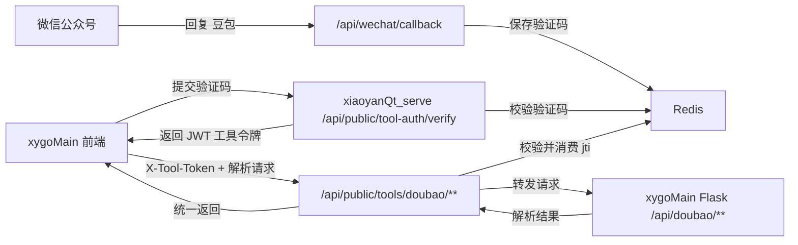

# 工具使用校验设计方案

## 背景

`xygoMain` 中的豆包工具当前每次使用都会弹出验证码弹窗，但验证码判断发生在前端，且使用固定值。这个方式只能改变交互流程，不能真正阻止绕过前端后直接请求接口。

本方案基于 `xiaoyanQt_serve` 现有配置和能力，将工具使用校验收敛到 Spring Boot 后端：

- 已有微信公众号回调，可在用户回复“豆包”时生成验证码。
- 已有微信公众号安全模式处理，可接收加密消息。
- 已有 Redis，可保存验证码、失败次数和一次性令牌状态。
- 已有 JWT 依赖和密钥体系，可生成和校验工具令牌。
- 已有公共接口安全链，可承载前端工具校验入口。

## 目标

- `xygoMain` 工具每使用一次都必须完成一次后端校验。
- 前端不再包含固定验证码或本地放行逻辑。
- `xiaoyanQt_serve` 提供新的 Spring Boot 工具接口，由该接口请求 Flask 豆包 API，并将结果返回前端。
- `X-Device-Id` 使用浏览器指纹，绑定验证码换取的工具令牌。
- `X-Tool-Token` 使用 JWT，但通过 Redis 中的 `jti` 状态实现一次性消费。
- 保留当前 Flask 豆包解析能力，不把 Python 解析器迁移到 Java。

## 非目标

- 不做完整用户登录体系。
- 不把微信公众号用户和站点账号绑定。
- 不迁移豆包解析器源码到 `xiaoyanQt_serve`。
- 不让前端直接调用 Flask 豆包解析接口作为最终安全边界。

## 推荐架构

采用“Spring Boot 工具校验网关 + Flask 保留解析器”的架构。



## 后端组件

### `ToolAuthController`

提供公共工具校验接口：

- `POST /api/public/tool-auth/verify`
- 请求体：`toolCode`、`code`
- 请求头：`X-Device=WEB`、`X-Device-Id=<浏览器指纹>`
- 成功返回：`toolToken`、`expiresIn`、`remainingUses`

该接口只负责“验证码换令牌”，不直接执行工具。

### `ToolAuthService`

负责验证码、工具令牌和失败次数：

- 校验验证码是否存在、是否匹配工具、是否过期。
- 校验成功后删除验证码，防止重复换取令牌。
- 生成带 `jti` 的工具 JWT。
- 将 `jti` 写入 Redis，保存令牌剩余使用次数和绑定设备。
- 校验工具请求时解析 JWT，并消费 Redis 中的 `jti`。

JWT 只作为签名和声明载体，不能单独代表“一次性”。一次性由 Redis 中的 `jti` 记录控制。

### `ToolJwtService`

建议不要直接复用管理员登录的 `JwtUtil.generateToken(username)`。可以复用 `jjwt`、`KeysUtil` 和 RSA 密钥，但新增工具令牌专用服务，避免和管理员 JWT 混用。

工具 JWT 建议包含：

```json
{
  "typ": "tool-token",
  "toolCode": "doubao",
  "deviceIdHash": "sha256(...)",
  "openIdHash": "sha256(...)",
  "jti": "uuid",
  "iss": "xiaoyanAi",
  "aud": "tool",
  "iat": 1717488000,
  "exp": 1717488600
}
```

### `DoubaoToolController`

提供新的 Spring Boot 工具接口：

- `POST /api/public/tools/doubao/images/analyze`
- `POST /api/public/tools/doubao/videos/analyze`

处理流程：

1. 读取 `X-Tool-Token`。
2. 校验 JWT 签名、过期时间、令牌类型、工具编码、设备指纹。
3. 原子消费 Redis 中的 `jti`。
4. 使用配置的 Flask 基础地址请求原 Flask API。
5. 将 Flask 响应状态码和响应体返回给前端。

### `WechatCallbackService`

现有“回复豆包生成验证码”的逻辑需要补齐 Redis 写入：

- 用户回复“豆包”时生成验证码。
- 记录验证码和微信 `openId` 的哈希。
- 回复用户验证码和有效期。
- 日志不输出完整 `openId`、验证码和令牌。

## Redis 设计

```text
tool:wechat:code:{toolCode}:{code}
  -> { toolCode, openIdHash, createdAt }
  TTL: 5 分钟

tool:token:jti:{jti}
  -> { toolCode, deviceIdHash, openIdHash, remainingUses }
  TTL: 10 分钟

tool:verify:fail:{deviceIdHash}
  -> 失败次数
  TTL: 10 分钟
```

验证码校验成功后删除验证码。工具请求成功进入解析前消费 `jti`，消费后无论 Flask 解析是否成功，该令牌都失效，以满足“每次使用一次都需要验证”。

## 浏览器指纹

前端生成 `X-Device-Id` 时使用浏览器指纹。指纹生成优先使用成熟前端库，不手写浏览器特征采集逻辑，降低维护成本和浏览器兼容风险。

建议实现方式：

- 如果项目中已存在同类指纹库，直接复用已有库。
- 如果当前依赖中没有指纹库，新增 `@fingerprintjs/fingerprintjs`，使用其 `visitorId` 作为浏览器指纹来源。
- 将库返回的指纹值作为 `X-Device-Id`；如需进一步脱敏，可在前端对 `visitorId` 再做 SHA-256 摘要。
- 指纹结果缓存到 `localStorage`，减少重复计算。
- 若指纹库加载失败，则回退到本地随机 UUID，并保存到 `localStorage`。

前端只发送最终指纹标识或摘要，不发送原始浏览器特征字段。

## API 草案

### 验证码换工具令牌

```http
POST /api/public/tool-auth/verify
X-Device: WEB
X-Device-Id: <browser-fingerprint>
Content-Type: application/json
```

```json
{
  "toolCode": "doubao",
  "code": "123456"
}
```

成功响应：

```json
{
  "toolToken": "jwt...",
  "expiresIn": 600,
  "remainingUses": 1
}
```

### 豆包图片解析

```http
POST /api/public/tools/doubao/images/analyze
X-Device: WEB
X-Device-Id: <browser-fingerprint>
X-Tool-Token: <jwt>
Content-Type: application/json
```

```json
{
  "url": "https://www.doubao.com/thread/..."
}
```

### 豆包视频解析

```http
POST /api/public/tools/doubao/videos/analyze
X-Device: WEB
X-Device-Id: <browser-fingerprint>
X-Tool-Token: <jwt>
Content-Type: application/json
```

```json
{
  "url": "https://www.doubao.com/thread/..."
}
```

## 配置

建议新增配置：

```yaml
xiaoyan:
  tool-auth:
    code-expire-minutes: ${TOOL_AUTH_CODE_EXPIRE_MINUTES:5}
    token-expire-minutes: ${TOOL_AUTH_TOKEN_EXPIRE_MINUTES:10}
    token-uses: ${TOOL_AUTH_TOKEN_USES:1}
    verify-fail-limit: ${TOOL_AUTH_VERIFY_FAIL_LIMIT:5}
    verify-lock-minutes: ${TOOL_AUTH_VERIFY_LOCK_MINUTES:10}
  tools:
    doubao:
      base-url: ${DOUBAO_TOOL_BASE_URL:http://127.0.0.1:5000/api/doubao}
      connect-timeout-millis: ${DOUBAO_TOOL_CONNECT_TIMEOUT_MILLIS:5000}
      read-timeout-millis: ${DOUBAO_TOOL_READ_TIMEOUT_MILLIS:30000}
```

前端 `vite.config.js` 也需要将新的 Spring Boot 工具路径代理到 `xiaoyanQt_serve`，同时保留 Flask 服务只由 Spring Boot 调用。

## 错误处理

- 验证码不存在或过期：返回验证码无效提示。
- 验证失败次数超过阈值：短时间锁定该 `deviceIdHash`。
- `X-Device-Id` 为空：拒绝工具令牌换取和工具调用。
- `X-Tool-Token` 缺失、过期、签名错误、类型错误：拒绝工具调用。
- `jti` 不存在：视为令牌已使用或失效。
- Flask 解析失败：透传可展示的失败信息，保持前端当前结果展示逻辑。

## 测试策略

后端测试：

- 微信“豆包”文本消息会保存验证码到 Redis 并回复验证码。
- 验证码正确时返回工具 JWT，并删除验证码。
- 验证码错误时记录失败次数。
- JWT 缺少工具声明、设备不匹配、工具不匹配、过期时拒绝。
- 同一个 JWT 第一次消费成功，第二次消费失败。
- 豆包工具接口会携带请求体转发到 Flask，并返回 Flask 响应。

前端测试：

- 提交豆包解析时先打开验证码弹窗，不直接调用解析接口。
- 输入验证码后调用 Spring Boot 验证接口。
- 验证成功后用返回的 `toolToken` 调用 Spring Boot 工具接口。
- 不再存在固定 `1234` 前端校验。
- 请求头包含 `X-Device=WEB`、`X-Device-Id`。
