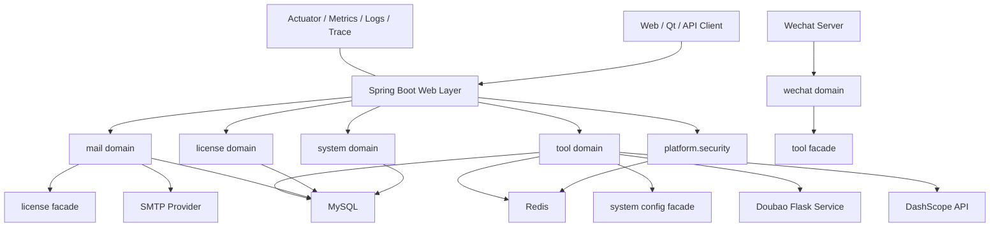

# xiaoyanQt_serve 后端架构重新设计方案

> 生成日期：2026-07-02  
> 说明：`2026-06-13-maven-multimodule-refactor.md` 已作废，本方案不沿用其 Maven 多模块拆分路径。

## 1. 设计结论

当前系统更适合先演进为“可治理的模块化单体”，而不是立即进行 Maven 多模块或微服务拆分。

原因如下：

1. 当前后端约 180 多个主代码文件，规模尚未大到必须物理拆分。
2. 现有系统已经具备统一异常、SecurityFilterChain、Redis、AOP、异步线程池、定时任务和部分单元测试，适合在单体内继续增强工程治理。
3. 当前最大风险不是部署形态，而是配置安全、模块边界、外部依赖稳定性、数据库变更治理、可观测性和测试覆盖。
4. 先做逻辑边界和运行治理，后续如果业务量继续扩大，再物理拆分 Maven module 或服务，风险会低很多。

推荐路线：

```text
阶段 1：安全配置治理 + 可观测性 + 数据库迁移治理
阶段 2：单 Maven 工程内按业务域重组 package
阶段 3：通过 Facade/Port 明确跨域调用边界
阶段 4：引入 ArchUnit、集成测试、CI 质量门禁
阶段 5：仅当边界稳定后，再考虑 Maven module 或服务拆分
```

## 2. 架构原则

### 2.1 不以拆分作为第一目标

拆分不是目的，降低变更风险才是目的。第一阶段不建议把项目立即改成多个 Maven module，因为这会带来大量文件移动、资源加载、Mapper 扫描、Bean 装配和测试迁移风险，但对当前稳定性提升有限。

第一阶段更应该做：

- 密钥和配置治理
- 数据库 migration
- 运行健康检查
- 外部依赖熔断降级
- 包结构按业务域收敛
- 测试补齐

### 2.2 业务域优先，而不是技术分层优先

保留 Spring Boot 单应用，但 package 结构从横向技术分层逐步演进为业务域优先：

```text
com.yan.xiaoyanqtserve
├── boot                  # 启动、全局装配
├── shared                # 稳定共享模型和通用能力
├── platform              # 基础设施适配：Redis、Security、Web、MyBatis、线程池、异常、日志
├── system                # 管理员、系统配置、版本、维护模式、请求日志
├── license               # 卡密、API Key、授权校验
├── mail                  # 邮件账号、邮件发送、申请记录、模板、定时任务
├── tool                  # 工具列表、工具授权、Doubao 代理、AIGC 工具
└── wechat                # 微信公众号回调、验签、加解密、消息回复
```

与旧计划不同：这里先做 package 级逻辑模块，不立刻做 Maven module 级物理模块。

### 2.3 跨域调用通过应用服务或 Facade

禁止 Controller、Mapper、Entity 在不同业务域之间随意互相调用。跨域调用应通过明确的 Facade 或应用服务接口完成。

示例：

```text
mail -> license
```

不建议：

```text
MailApplyManagerService 直接操作 KeyInfoMapper
```

建议：

```text
MailApplyManagerService -> LicenseGrantFacade -> KeyInfoManagerService/Repository
```

这样后续即使 `license` 物理拆分，`mail` 也不需要理解卡密内部细节。

## 3. 推荐目标结构

### 3.1 `boot`

职责：

- 应用启动类
- Profile 激活策略
- 全局 Bean 装配入口
- OpenAPI、Actuator、Scheduler、Async 开关

建议迁入：

- `XiaoyanQtServeApplication`
- 仅与启动装配直接相关的配置

### 3.2 `shared`

职责：

- 通用响应模型
- 稳定 DTO/VO
- 业务状态码
- 通用枚举
- 纯工具类
- 业务异常基类

限制：

- 不依赖 Controller
- 不依赖 Mapper
- 不依赖 Redis
- 不依赖 Security
- 不依赖具体业务 Service

建议包含：

- `BizException`
- `BizStatus`
- `ApiResponse`
- `Constants`
- 通用 DTO、VO、Enum
- `VersionCheckUtil`、`IdUtil` 等纯工具类

### 3.3 `platform`

职责：

- 框架集成和运行时基础设施
- Web 配置
- Security 配置
- Redis 配置与工具
- MyBatis 配置
- 全局异常处理
- AOP
- Filter
- Interceptor
- ThreadPool
- 日志、Trace、Metrics

建议包含：

- `SecurityConfig`
- `RedisConfig`
- `MybatisPlusConfig`
- `WebConfig`
- `ThreadPoolConfig`
- `GlobalExceptionHandler`
- `RequestLoggingInterceptor`
- `RateLimiterAspect`
- `CaptchaValidationAspect`
- `JwtAuthFilter`
- `ApiKeyAuthFilter`
- `SystemModeFilter`
- `RedisUtil`
- `RedisLockUtil`

注意：如果某个基础设施类强依赖业务 Service，应优先通过接口抽象解耦，而不是把业务实现拖进 `platform`。

### 3.4 `system`

职责：

- 管理员账号
- 登录与后台认证支撑
- 系统配置
- 版本检查
- 维护模式
- 产品类型
- 请求日志查询

建议边界：

- 对外提供 `SystemConfigFacade`
- 其他业务域只通过 Facade 读取系统配置，不直接依赖 `SysConfigMapper`
- 请求日志写入可由 `platform` 触发，但查询和管理属于 `system`

### 3.5 `license`

职责：

- 卡密生成
- 卡密激活
- API Key 校验
- 免费卡密池
- 授权状态判断
- 卡密加密、签名、校验

建议边界：

- 对外提供 `LicenseGrantFacade`
- 对外提供 `ApiKeyValidationFacade`
- `mail`、`tool`、`platform` 不直接访问 `KeyInfoMapper`

### 3.6 `mail`

职责：

- 邮箱账号管理
- 多邮箱发送策略
- 邮件模板渲染
- 验证码邮件
- 免费卡密申请邮件
- 邮件发送记录
- 邮件账号健康与限额任务

建议边界：

- 对外提供 `MailSendFacade`
- 邮件发送失败要可重试、可记录、可补偿
- 邮件模板渲染和发送通道分离，便于测试

### 3.7 `tool`

职责：

- 工具分类和工具项
- 主站工具列表
- 工具缓存
- 工具授权码
- Tool Token
- Doubao 工具代理
- AIGC 文本处理

建议边界：

- `ToolAuthService` 只负责授权码和 Tool Token
- `DoubaoToolProxyService` 只负责外部 Flask 调用
- `AigcProcessingService` 负责编排输入校验和模型调用
- `ModelService` 负责模型供应商适配，后续可抽象为 `ModelClient`

### 3.8 `wechat`

职责：

- 微信服务器回调
- URL 验签
- 加解密
- XML 消息解析
- 菜单和关注回复
- 通过工具授权能力生成验证码

建议边界：

- `wechat` 可以依赖 `tool` 的授权 Facade
- 不建议直接写工具授权 Redis key
- 微信 openId 等敏感标识进入日志前必须脱敏

## 4. 配置与密钥治理

这是最高优先级。

当前配置文件中存在明文密钥、邮箱授权码、数据库账号、Redis 密码、云服务 AK/SK、微信密钥、RSA 私钥等风险。建议立即整改：

1. 删除仓库中的真实 secret。
2. 增加 `.env.example`，只保留变量名和示例占位值。
3. 生产环境从环境变量、Docker Secret、Kubernetes Secret 或 Vault 读取。
4. 所有已入库 secret 视为泄露，必须轮换。
5. `application-dev.yaml` 允许本地默认值，但不得出现真实云服务密钥。
6. `application-prod.yaml` 不允许 secret 默认值。
7. `@ConfigurationProperties` 增加 `@Validated`。
8. 启动时校验关键配置，失败则 fail fast。

建议配置分层：

```text
application.yaml          # 通用非敏感默认配置
application-dev.yaml      # 本地开发配置，不放真实云密钥
application-prod.yaml     # 生产环境变量引用
.env.example              # 环境变量样例
```

## 5. 稳定性设计

### 5.1 Actuator 健康检查

引入：

- `spring-boot-starter-actuator`
- `micrometer-registry-prometheus`

暴露：

```text
/actuator/health/liveness
/actuator/health/readiness
/actuator/metrics
/actuator/prometheus
```

健康检查覆盖：

- MySQL
- Redis
- Mail SMTP
- Doubao Flask 服务
- DashScope API Key 配置存在性
- 系统维护模式状态

### 5.2 外部依赖隔离

需要治理的外部依赖：

- DashScope 模型服务
- Doubao Flask 服务
- SMTP 邮件服务
- Aliyun Captcha
- Redis
- MySQL

建议引入 `resilience4j`：

- Timeout
- Retry
- CircuitBreaker
- Bulkhead
- RateLimiter

不同依赖使用不同策略：

| 外部依赖 | 策略 |
---|---|
DashScope | timeout + retry + circuit breaker + 模型轮询 |
Doubao Flask | timeout + circuit breaker + bulkhead |
SMTP | retry + 异步队列 + 失败记录 |
Aliyun Captcha | timeout + circuit breaker |
Redis | 明确降级策略，避免静默成功 |
MySQL | 交给连接池和事务治理 |

### 5.3 线程池外置化

当前线程池参数应从硬编码迁移到配置：

```yaml
xiaoyan:
  executors:
    aigc:
      core-size: 4
      max-size: 8
      queue-capacity: 500
    mail:
      core-size: 2
      max-size: 8
      queue-capacity: 200
    logging:
      core-size: 2
      max-size: 4
      queue-capacity: 1000
```

并补充：

- 线程池 metrics
- 拒绝策略告警
- 异步异常处理器
- 任务执行 traceId 传递

## 6. 数据库治理

当前 `sql/back` 更像手工备份，不能替代企业级数据库变更管理。

建议引入 `Flyway`：

```text
src/main/resources/db/migration
├── V1__init_schema.sql
├── V2__add_mail_account_status.sql
└── V3__add_tool_auth_table.sql
```

原则：

1. 所有 DDL 必须进入 migration。
2. 禁止生产环境手工改表后不入库。
3. 初始化结构、基础字典、测试数据分开。
4. 每次发布前在 CI 中从空库执行 migration。
5. 回滚以“向前修复”为主，不依赖直接 downgrade。

## 7. API 设计治理

### 7.1 路径分区

建议保留现有路径兼容，但新接口按以下方式收敛：

```text
/api/public/**       # 无登录公开接口
/api/main/**         # 主站公开业务接口
/api/key/**          # API Key 认证接口
/api/admin/**        # 后台 JWT 认证接口
/api/wechat/**       # 微信回调接口
/internal/**         # 内部运维接口，默认不对公网开放
```

### 7.2 REST 语义逐步统一

当前存在 `POST /delete/{id}`、`GET /delete/{id}` 等接口风格。建议新接口统一：

```text
GET    /resources
GET    /resources/{id}
POST   /resources
PUT    /resources/{id}
DELETE /resources/{id}
```

旧接口先保留兼容，再标记 Deprecated。

### 7.3 测试接口治理

`/api/public/test/**` 不应在生产环境公开。

建议：

- `TestController` 只在 `dev` profile 注册
- 或迁移为 `/internal/test/**`
- 或加管理员权限
- 邮件发送、同步邮件记录、重置免费卡密池这类操作必须进入受控运维入口

## 8. 可观测性设计

### 8.1 日志

建议统一结构化日志字段：

```text
traceId
requestId
userId/adminId
apiKeyId
deviceIdHash
clientVersion
path
method
status
bizCode
costMs
exceptionType
```

敏感字段必须脱敏：

- API Key
- JWT
- Tool Token
- openId
- 邮箱
- 手机号
- 验证码
- RSA 私钥
- 云服务 AK/SK

### 8.2 指标

建议重点指标：

- API QPS、RT、错误率
- Redis 命中率
- 邮件发送成功率、失败率、退信率
- Doubao Flask 调用耗时和失败率
- DashScope 调用耗时、失败率、Token 消耗
- 验证码校验失败次数
- API Key 拒绝次数
- 线程池队列长度和拒绝次数

### 8.3 Trace

如果暂时不接入 OpenTelemetry，也至少要做到：

- 每个请求生成 requestId
- 异步任务继承 requestId
- 外部 HTTP 调用带 requestId header
- 日志可按 requestId 串联

## 9. 测试策略

当前测试数量偏少，应按风险补齐。

### 9.1 单元测试

优先补：

- `ToolAuthService`
- `ToolJwtService`
- `ToolCacheManager`
- `WechatCryptoService`
- `WechatMessageParser`
- `KeyInfoManagerService`
- `MailApplyManagerService`
- `VersionCheckUtil`

### 9.2 集成测试

建议引入 Testcontainers：

- MySQL container
- Redis container

覆盖：

- API Key Filter
- JWT Filter
- 维护模式 Filter
- Mapper XML 加载
- Redis 缓存行为
- Flyway migration

### 9.3 架构测试

引入 `ArchUnit`，限制依赖方向：

```text
shared 不依赖任何业务域
platform 不直接依赖具体 Controller
controller 不直接访问 mapper
跨业务域只能通过 facade/application service
wechat 不直接操作 tool 的 Redis key
mail 不直接访问 license 的 mapper
```

## 10. 实施路线

### 阶段 0：基线确认

目标：确认当前项目可编译、可测试、可启动。

任务：

1. 记录当前 `mvn test` 结果。
2. 记录当前 `mvn package` 结果。
3. 记录启动所需环境变量。
4. 记录核心接口冒烟测试清单。

### 阶段 1：安全和配置治理

目标：消除最高风险。

任务：

1. 移除仓库中的真实 secret。
2. 新增 `.env.example`。
3. 生产配置全部改为环境变量。
4. 增加配置校验。
5. 轮换已泄露密钥。

### 阶段 2：运行治理

目标：让系统生产可观测、可诊断。

任务：

1. 引入 Actuator。
2. 增加健康检查。
3. 增加 Prometheus metrics。
4. 统一 requestId。
5. 敏感日志脱敏。

### 阶段 3：稳定性治理

目标：外部依赖失败时不拖垮主服务。

任务：

1. 对 Doubao Flask 增加熔断、timeout、bulkhead。
2. 对 DashScope 增加 timeout、retry、circuit breaker。
3. 对邮件发送增加失败记录和补偿机制。
4. 线程池参数外置。

### 阶段 4：数据库治理

目标：数据库变更可追溯、可自动验证。

任务：

1. 引入 Flyway。
2. 整理当前 schema 为 baseline。
3. 后续 DDL 全部 migration 化。
4. CI 验证 migration。

### 阶段 5：包结构重组

目标：在单 Maven 工程内形成业务域边界。

任务：

1. 新建目标 package。
2. 按业务域迁移少量高内聚类。
3. 每次迁移后运行测试。
4. 不做大规模一次性移动。
5. 保持 API 路径不变。

### 阶段 6：Facade 和架构测试

目标：让边界可以被工具守住。

任务：

1. 定义跨域 Facade。
2. 替换直接 Mapper/Service 跨域调用。
3. 引入 ArchUnit。
4. 将架构规则加入 CI。

### 阶段 7：再评估物理拆分

当满足以下条件后，再考虑 Maven module：

- package 边界稳定至少 2-3 个版本
- ArchUnit 规则稳定
- 集成测试覆盖核心链路
- CI 能可靠运行
- 明确存在独立发布或依赖隔离诉求

否则不建议为了“看起来架构更大”而拆分。

## 11. 最终目标架构图



## 12. 优先级清单

| 优先级 | 改进项 | 原因 |
|---|---|---|
| P0 | 移除真实 secret 并轮换 | 当前最高安全风险 |
| P0 | 生产配置环境变量化 | 降低部署和泄露风险 |
| P1 | Actuator + 健康检查 | 支撑生产运维 |
| P1 | Flyway | 数据库变更可控 |
| P1 | 外部依赖熔断降级 | 防止级联故障 |
| P1 | `TestController` 生产隔离 | 防止公开运维能力 |
| P2 | package 按业务域重组 | 提升维护性 |
| P2 | Facade 边界 | 降低跨域耦合 |
| P2 | ArchUnit | 防止架构腐化 |
| P2 | Testcontainers | 提升回归可靠性 |

## 13. 不建议事项

当前阶段不建议：

1. 立即 Maven 多模块重构。
2. 立即微服务拆分。
3. 一次性大规模改包名。
4. 重写现有业务逻辑。
5. 引入消息队列来替代所有异步逻辑。
6. 在没有迁移测试的情况下调整 Mapper XML 路径。

这些动作看起来“架构感”很强，但短期更容易制造回归风险。

## 14. 验收标准

阶段性验收：

- `mvn test` 通过。
- `mvn package` 通过。
- 生产配置不包含真实 secret 默认值。
- Actuator readiness 能反映 MySQL、Redis 和关键外部依赖状态。
- Flyway 能从空库初始化 schema。
- 核心接口冒烟测试通过。
- `TestController` 不在生产公开。
- ArchUnit 能阻止关键反向依赖。
- 日志中不输出 API Key、JWT、验证码、openId、私钥等敏感信息。

